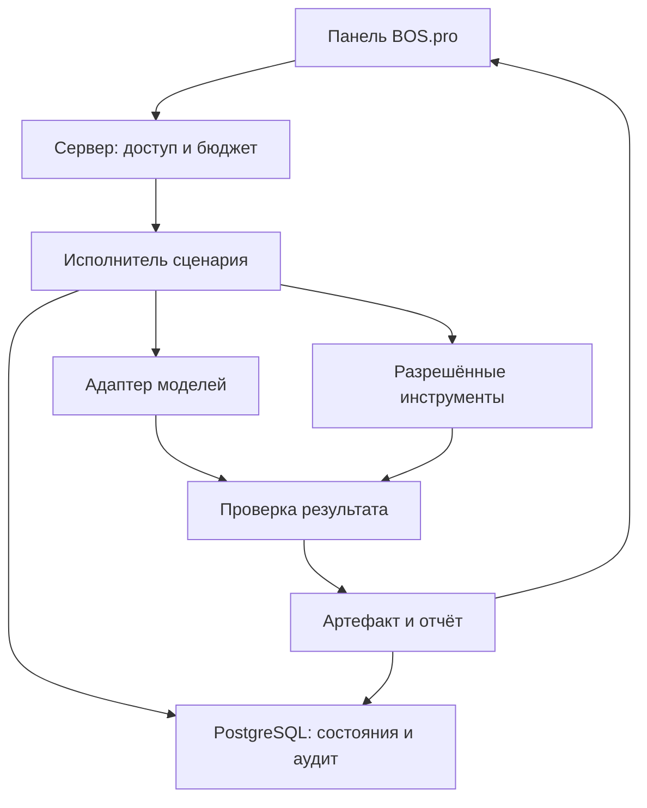

# Архитектура BOS.pro

Статус: проектное предложение. Перечисленные компоненты ещё не подключены.

## Границы компонентов

Панель пользователя показывает задачи, версии результатов, проверки и согласования.
React Flow может стать редактором сценариев позднее. Первая версия использует
один серверный сценарий; хранение JSON-графа само по себе не создаёт исполнителя.

Сервер проверяет пользователя, workspace, входной контракт, разрешённые инструменты
и бюджет. Затем создаёт снимок запуска и выполняет ограниченный набор шагов.
Исполнитель не принимает произвольные команды из текста модели.

Данные хранятся в PostgreSQL. Supabase рассматривается как оболочка для Auth,
PostgreSQL и Realtime; решения о размещении и доступных ресурсах принимаются отдельно.
Для первого текстового сценария нужно выбрать минимальный способ фонового исполнения.
BullMQ/Redis становятся конкретным вариантом при необходимости устойчивых очередей.

Заметки модели, факты источников и разрешения пользователя хранятся раздельно.
Проверка результата может использовать правила и модельную рецензию, но итоговый
отчёт содержит основания, а не только оценку второй модели.

## Место проектов AAIF

| Проект | Предлагаемая роль | Условие подключения |
| --- | --- | --- |
| AGENTS.md | Общие правила репозитория | Черновик уже включён в пакет |
| Agent Skills | Версионируемые навыки исследования, подготовки и проверки | После определения одного сценария и его проверок |
| MCP | Ограниченные интерфейсы к инструментам и данным | По мере появления конкретных интеграций |
| Open Responses | Общий контракт модельных запросов | При выборе совместимых endpoint и проверке нужных возможностей |
| OpenSandbox | Изолированное исполнение кода и агентских задач | Перед предоставлением такого исполнения, после оценки ресурсов |
| A2A | Передача задач между самостоятельными агентскими сервисами | При фактической необходимости межсервисного взаимодействия |
| Agent Router | Управление доступом к моделям/MCP и маршрутизацией | При усложнении доступа, бюджета и нескольких поставщиках |
| agentgateway | Альтернативный шлюз к моделям и инструментам | Сравнить с Agent Router по одному реальному сценарию |
| OpenEnv | Среды оценки и последующего обучения агента | После появления измеримой задачи и корректного критерия результата |
| goose | Дополнительный готовый агент разработки | Опционально, после сравнения с уже используемыми инструментами |

Разработка AAIF не устраняет необходимость в собственной модели прав, бюджете,
подтверждениях и проверке результата. Наличие общей спецификации не удостоверяет
полную совместимость каждой модели и каждого набора инструментов.

## Путь одного запуска

1. Приём задачи и проверка схемы.
2. Проверка доступа, разрешённых источников и бюджета.
3. Снимок входов, сценария и версий правил.
4. Выполнение разрешённых шагов с журналом и ограниченными повторами.
5. Проверка результата и сохранение отчёта.
6. Показ пользователю результата и действий, требующих подтверждения.
7. Выполнение конкретного подтверждённого внешнего действия и проверка его исхода.

Сбой соединения после внешнего запроса требует проверки состояния по внешнему
идентификатору. Слепая повторная публикация или повторная покупка генерации не допускается.

## Предварительные ограничения

Для первой версии не требуется одновременно внедрять все десять проектов AAIF.
Обучение с подкреплением, универсальный редактор процессов и распределённая сеть
агентов находятся за пределами первого сценария. Автоматическая оптимизация
рекламных бюджетов не включена в черновую первую версию.

## Схема первого сценария

Схема описывает целевое устройство. Внешнее изменение выполняется отдельным
серверным действием с проверкой подтверждения, версии результата и назначения.
